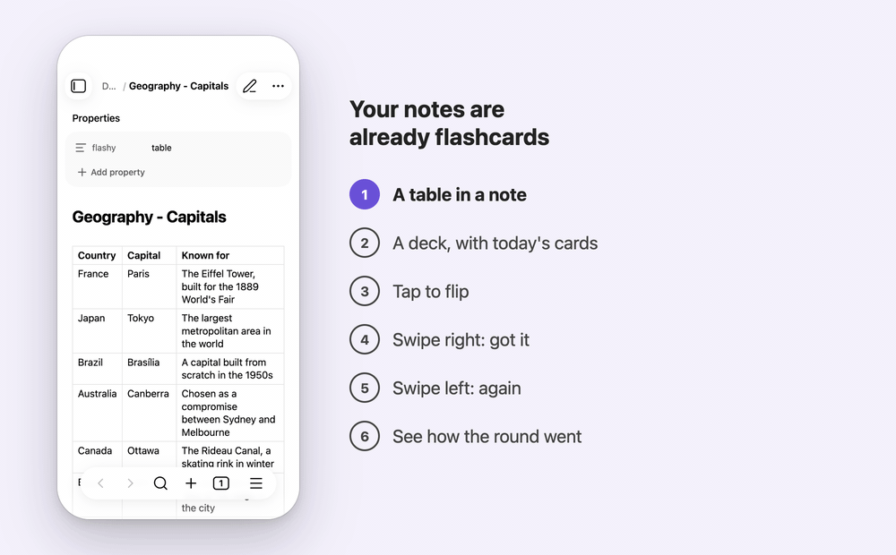
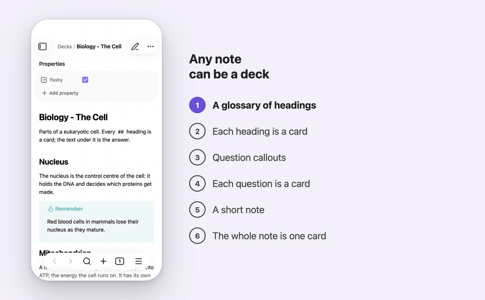
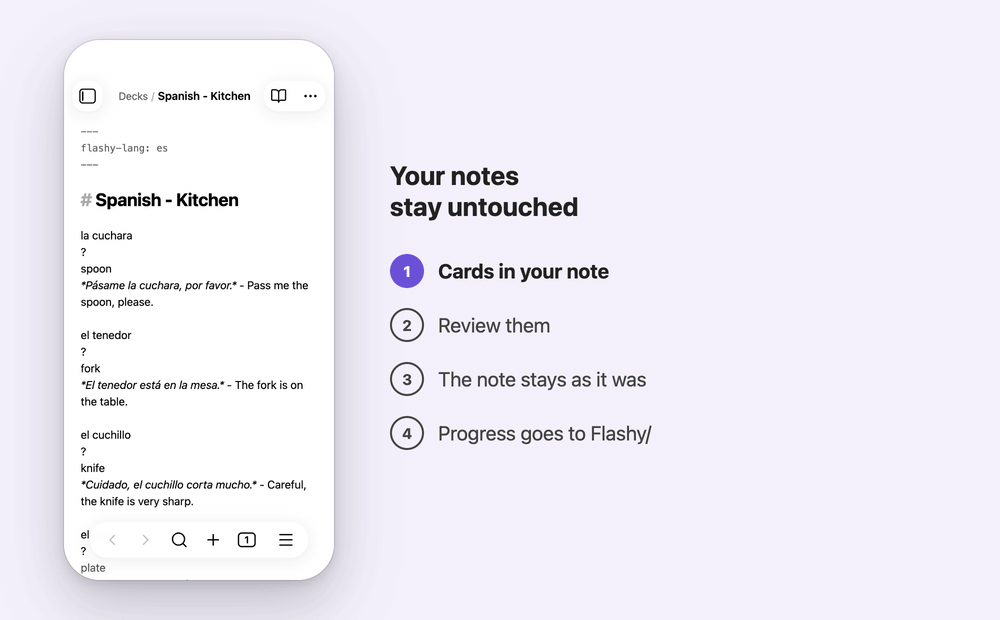
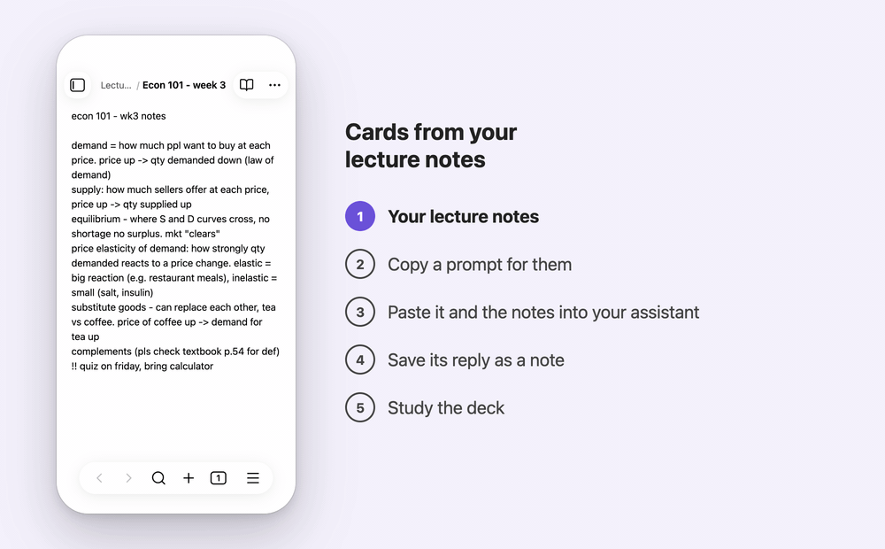
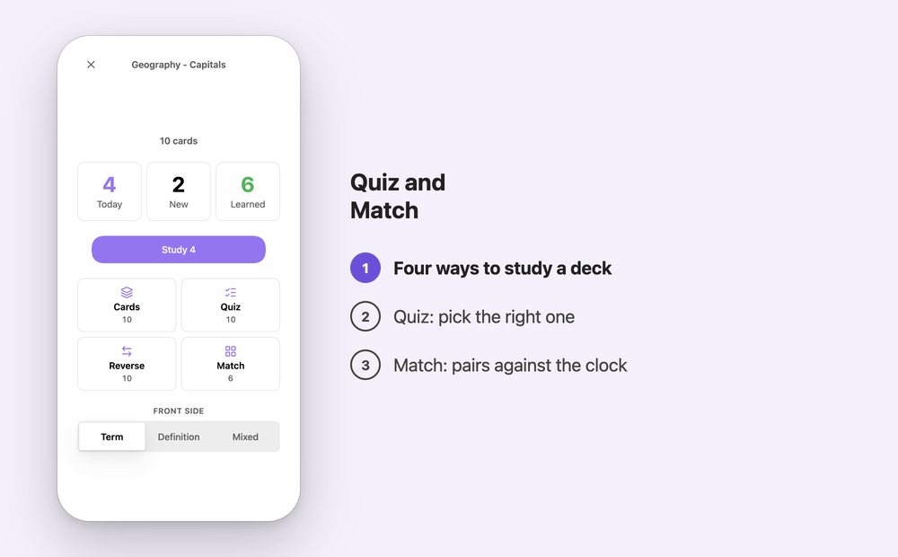

# Flashy

<picture>
  <source media="(prefers-color-scheme: dark)" srcset="https://raw.githubusercontent.com/Dimagious/flashidian/HEAD/docs/banner-dark.svg">
  
</picture>

**Your notes are already flashcards.**

Headings, tables, lists and question callouts become a deck as they are. Review with a tap and a swipe on your phone. Nothing is written into your notes.

**Install:** Settings → **Community plugins** → **Browse** → search for **Flashy**. Until Flashy is listed there, install it with [BRAT](https://github.com/TfTHacker/obsidian42-brat) from `Dimagious/flashidian`. Then open a note with a table or a glossary, add the property `flashy: true` and run **Flashy: Review cards in the current note**.

[Every format and setting](docs/reference.md) · [Changelog](CHANGELOG.md)

## Why Flashy

- **No card syntax.** The notes you already have are the deck: a glossary, a table, a list, a callout with a question.
- **Made for the phone.** One card at a time, a 3D flip, swipe right when you know it, left to see it again.
- **Your notes stay clean.** No scheduling comments, no IDs. Progress lives in a `Flashy/` folder and syncs without conflicts.
- **FSRS scheduling**, and the multi-line `?` format of the Spaced Repetition plugin works as it is.

## Any note can be a deck

A glossary of `##` headings, question callouts, or a whole short note as one card. A table and a list work the same way.

## Your notes stay untouched

Reviews go to a log in `Flashy/`, one file per device, so two devices never conflict. Each deck gets a note with its numbers as properties, ready for Bases.

## Cards from your lecture notes

Copy a ready prompt, paste it with your notes into the assistant you use, and save the reply as a note: it is a deck. Four prompts, for lecture notes, foreign words, a chapter and short notes, each [checked on 24 sample inputs](evals/prompts/). Flashy itself calls no model and sends nothing anywhere.

## Quiz and Match

Four ways through a deck: cards, a quiz, a reverse quiz, and Match, pairs against the clock with a best time per deck. The quizzes and Match leave the schedule alone.

## Coming from Spaced Repetition

Your `?` decks open as they are, and Flashy leaves the plugin's `<!--SR:...-->` comments alone, so both plugins can run on the same notes. Flashy keeps its own schedule: your Spaced Repetition history does not carry over.

## Seven languages

English, Russian, Spanish, German, French, Portuguese and Japanese. Flashy follows Obsidian's language; pick another under **Language** in the settings.

The clips are the plugin running in Obsidian's mobile interface, in a phone-sized window on a desktop, with a demo vault.

## License

MIT
